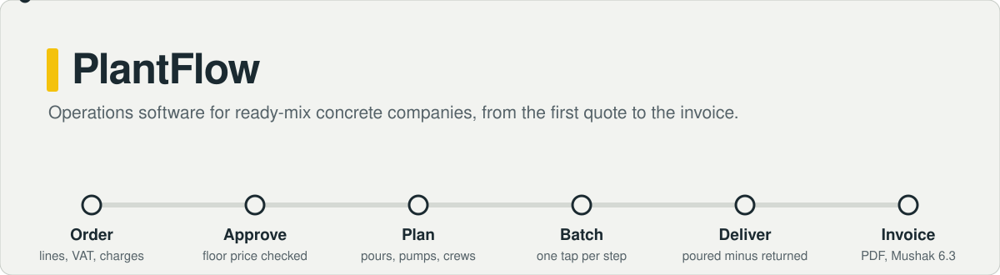
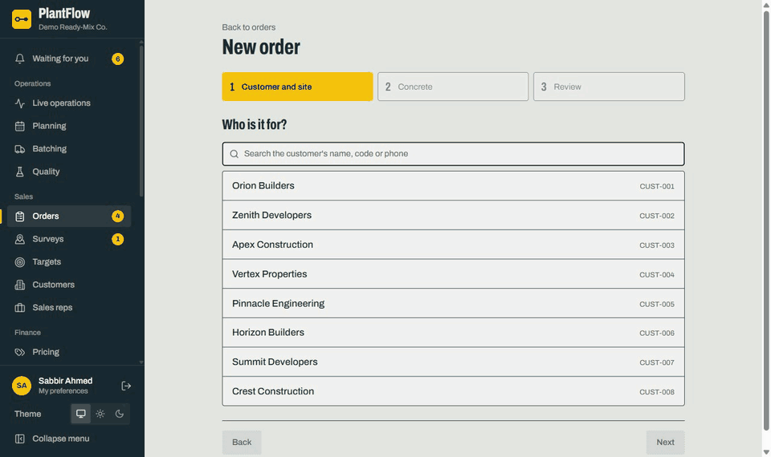
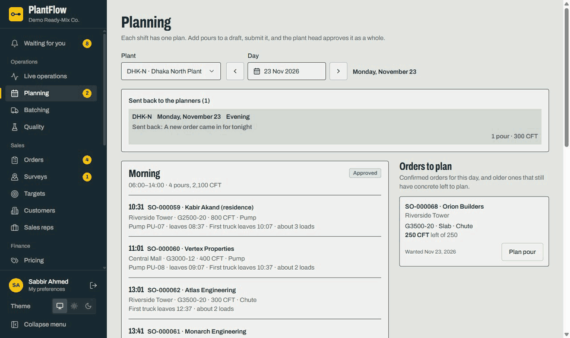
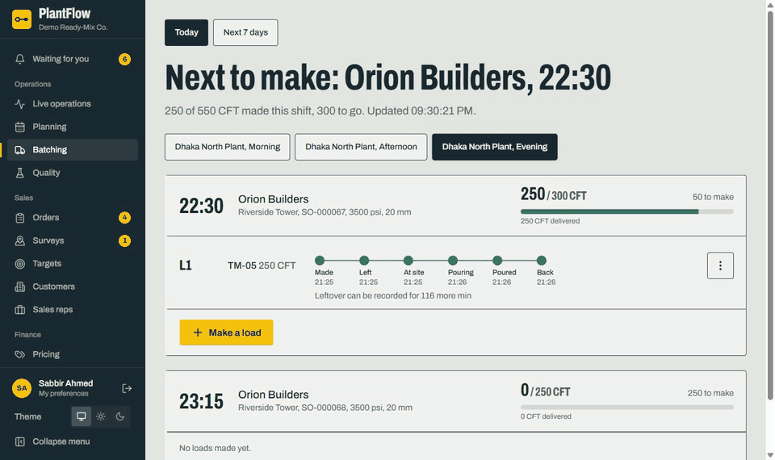
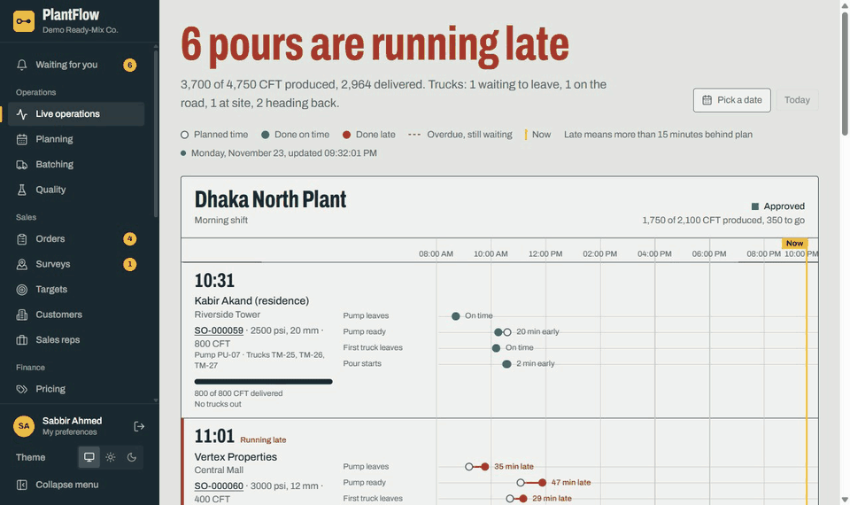

<picture>
  <source media="(prefers-color-scheme: dark)" srcset="assets/hero-dark.svg">
  
</picture>

**PlantFlow** is a multi-company web platform that runs a ready-mix concrete business end to end: sales orders and pricing, shift planning, batching and dispatch, returns and quality control, invoicing and live dashboards.

> This repository is a showcase. **PlantFlow** is proprietary software and its source code is private. Engineers reviewing my work can ask for read access :

## Why this is hard

Ready-mix concrete starts setting the moment it is mixed. An order becomes several pours; each pour needs a pump, a crew and a steady stream of mixer trucks, and every minute a truck waits on site costs money. Prices must stay above a cost that moves with materials, distance and overheads, and the customer pays for what was actually poured, not what was ordered. Most plants run this on phone calls and spreadsheets.

## See it working

The four clips follow one order through a working day: it is created and approved, planned into the evening shift, batched and delivered, and then shows up on the live board.

### An order, from draft to confirmed

A sales rep builds the order; PlantFlow prices every line against a floor worked out from the approved recipe and costs, routes it through the right approvals, and the customer confirms.

### Planning the day

Each plant plans its shift as a set of pours with pumps and crews. Clashes, pump rest and missing site surveys are caught before the plan is approved.

### The batching console

Built for the plant operator on a tablet. Each pour is a card, late pours come first, and the one thing to do next is always the yellow button.

### The live operations board

Planned against actual time for every step of every pour. A ring is the plan, a dot is what happened, and anything more than a set number of minutes behind turns red.

<picture>
  <source media="(prefers-color-scheme: dark)" srcset="assets/load-cycle-dark.svg">
  
</picture>

## What it covers

| Area              | What the software does                                                                                                                                                |
| ----------------- | --------------------------------------------------------------------------------------------------------------------------------------------------------------------- |
| Sales and pricing | Orders with service charges and VAT options, approval stages, amendments to running orders, expiry of unconfirmed orders, a price book where every change is approved |
| Planning          | Site surveys with GPS and photos, shift plans with pumps and crews, plan approval by the plant manager                                                                |
| Plant floor       | Batching console, delivery notes, returned and rejected concrete inspected, reused, treated or dumped                                                                 |
| Billing           | Invoices in commercial and Mushak 6.3 layouts, cancel and reissue, a customer volume ledger                                                                           |
| Management        | Live dashboards, a management report with trends and targets, Excel and CSV exports                                                                                   |
| Running a company | Self-service onboarding, 11 default roles and 50+ permissions, users limited to their plants, a full audit log                                                        |

## How it's built

<picture>
  <source media="(prefers-color-scheme: dark)" srcset="assets/guards-dark.svg">
  
</picture>

- **Many companies, one database, isolation in one place.** Every company-owned table carries a company id, and a single EF Core global query filter applies it to every query. Another company's records simply don't exist to you: their ids return 404.
- **The API decides access, not the screen.** Permissions load per request, cached briefly and cleared on any change. An explicit deny beats a role's grant, a disabled user is out on the next request, and an admin can't lock themselves or the company out.
- **Approved records never change.** An approved price, cost or recipe is never edited; a change is a new row that goes through approval, so every past order can be explained.
- **One place for money rules.** A single service turns loads and returns into the billed quantity, so no two screens can disagree about what a customer owes.
- **Everything is audited.** Every state change records who, when and what changed.
- **Built for the people using it.** Field screens are designed for a phone at 390 px with large touch targets; the operator's console shows one next action at a time.

### Testing

About **400 integration tests** start a real SQL Server in Docker with Testcontainers, apply the real migrations and call the real API. Every endpoint is tested for its happy path, each refusal message, its permission gate and isolation from other companies. CI runs them on every pull request, along with lint and a production build of the web app.

## Tech stack

|         |                                                                                                          |
| ------- | -------------------------------------------------------------------------------------------------------- |
| API     | .NET 10, ASP.NET Core Web API, EF Core 10, SQL Server 2022, Firebase Authentication, QuestPDF, ClosedXML |
| Web     | React 19, TypeScript, Vite, Tailwind CSS 4, shadcn/ui, TanStack Query and Table, React Router            |
| Quality | xUnit, Testcontainers, Docker, GitHub Actions, ESLint                                                    |

## About

Designed and built by **Sabbir Ahmed**, full-stack engineer in Dhaka, from public knowledge of how ready-mix plants work. The demo data in the clips is made up.

[LinkedIn](https://linkedin.com/in/s-a-b-b-i-r-ahmed) · [GitHub](https://github.com/S-a-b-b-i-R) · hiresabbirahmed@gmail.com

© 2026 Sabbir Ahmed. The images and text in this repository may not be reused without permission. PlantFlow is proprietary software.
